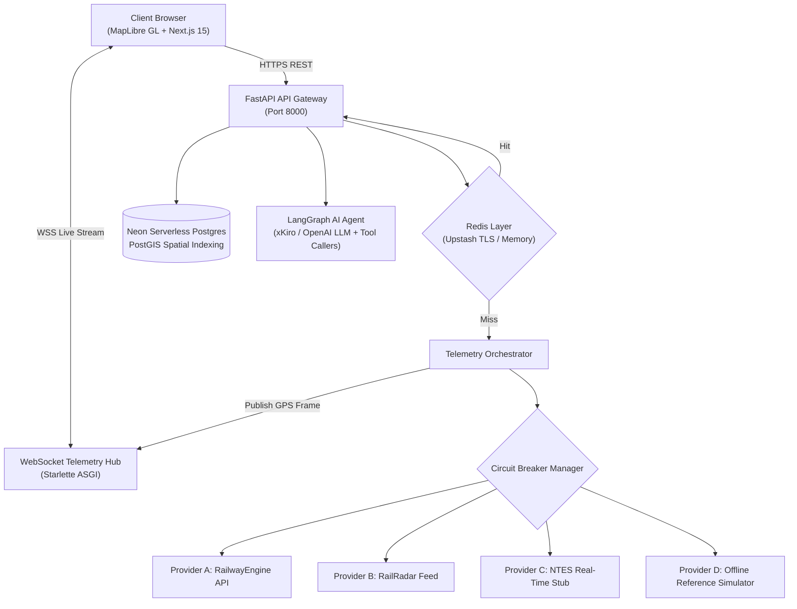
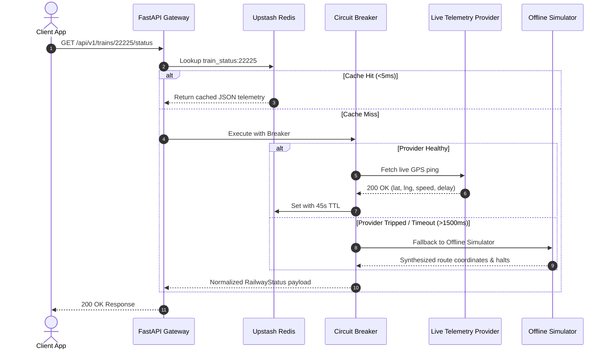

# System Architecture Blueprint — RailPulse (Railway-App)

This document specifies the technical design, component boundaries, telemetry ingestion pipelines, and fault-tolerance mechanisms of **RailPulse** — an AI-powered Indian Railway Tracking SaaS Engine.

---

## 1. High-Level Architecture

---

## 2. Core Subsystems

### A. Next.js 15 App Router Frontend
* **Runtime**: React 19 / Next.js 15 App Router with Partial Prerendering (PPR).
* **Geospatial Canvas**: MapLibre GL rendering high-frequency GeoJSON train track features and station markers over OpenStreetMap tiles.
* **Telemetry Synchronization**:
  * Persistent WebSocket listener consuming sub-second coordinate delta frames.
  * Linear coordinate interpolation (LERP) across polyline segments to eliminate visual jitter.
  * Zustand reactive store scoping component re-renders exclusively to active train IDs.

### B. FastAPI Asynchronous Backend Gateway
* **Routing Hierarchy**: Dual-prefix routing supporting `/api/v1` and legacy `/v1` endpoints.
* **Validation**: Pydantic v2 strict schema verification on all request payloads and responses.
* **Error Handling**: Custom `RequestValidationError` handler intercepting non-finite inputs (NaN, Infinity).
* **CLI Diagnostics**: Built-in developer CLI (`python -m app.cli [status|search|info]`).

### C. Live Telemetry Pipeline & Caching
* **Primary Cache**: Upstash Redis TLS with REST API fallback for serverless scaling.
* **Dynamic TTL Decay**: Active moving trains use a 30s–60s dynamic TTL inversely proportional to velocity; halted trains use an extended 180s TTL.
* **Resilience**: In-memory `TTLCache` fallback automatically engages if external Redis latency spikes above 800ms.

### D. Multi-Provider Fallback & Circuit Breakers
The ingestion orchestrator evaluates providers through an adaptive circuit breaker:

### E. Grounded LangGraph AI Travel Assistant
* **State Management**: PostgreSQL state checkpointer (`thread_id`) preserving conversational context across turns.
* **Intent Classifier**: Maps natural language queries to discrete tool calls (`lookup_train_status`, `calculate_fare`, `check_station_halts`).
* **Hallucination Prevention**: Strict entity validation verifying that train numbers exist in the reference directory before LLM synthesis.

---

## 3. Database Schema (Neon PostgreSQL + PostGIS)

The relational schema is configured for zero-downtime branching on Neon:

* `stations`: Master station registry with `code` (PK), `name`, `state`, and PostGIS geometry point `geom (Point, 4326)`.
* `trains`: Metadata directory with `number` (PK), `name`, `type`, `origin_code`, `destination_code`.
* `train_halts`: Scheduled route timetable storing `train_number`, `station_code`, `day_count`, `scheduled_arrival`, `scheduled_departure`, and `distance_km`.
* `telemetry_history`: Historical delay analytics tracking on-time performance trends.

---

## 4. Security & Operational Hardening

1. **WAF & Rate Limiting**: Token-bucket rate limiting (120 req/min per IP) via Upstash Redis.
2. **CORS Governance**: Whitelisted Cloudflare Pages domains (`railpulse.pages.dev`) in production.
3. **Container Healthchecks**: Built-in Docker `HEALTHCHECK` probing `GET /` with automatic restart on container freeze.
